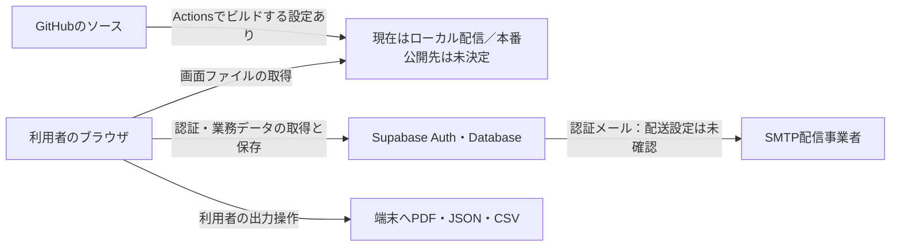

# 5番：外部サービス一覧と利用方法の整理

確認日：2026-10-26。状態：調査・比較用。SBへの提出・承諾取得、本番構成の採用、移行は未実施。

## 現在分かったこと

- 業務データはユーザー回答で架空データだけ。認証に使う本人のメールアドレス、認証記録、アクセス情報まで架空という意味ではない。
- ローカルの改修では、通常画面の通信先を自サイトと設定したSupabaseへ限定した。地図・住所検索・外部フォントの自動取得を停止した。
- ローカル画面は127.0.0.1だが、認証・案件・契約等の処理先はクラウドのSupabase。端末内だけで完結する構成ではない。
- GitHubへの過去の送信はあるが、直近の改修は未プッシュ。公開中のサイトの版・Pages設定・最新の配信結果は今回未確認。下記の「停止済み」はローカルの改修状態であり、既存の公開サイトまで停止を確認した意味ではない。
- Supabaseの保存先リージョンはユーザー回答「不明」。日本・東京と推測しない。

## データの流れ

画面配信事業者にDBそのものを置かなくても、アクセス記録・配信ファイル・配信コードへの管理権限は別途確認する。図は論理構成で、ログ・バックアップ・運用支援先の全経路を省略なく示したものではない。

## 外部サービス管理台帳

| サービス／役割 | 現在の状態 | 処理・保存する情報 | 保存国・処理地域 | 再委託先の確認 | 返還・削除の確認 |
| --- | --- | --- | --- | --- | --- |
| Supabase Auth／個人認証 | 利用中 | ログイン時のメール・パスワード、追加認証コード、Auth側の認証情報・パスワードハッシュ・セッション・認証ログ等。アプリの業務表に平文パスワード列は設けない | 当該プロジェクトのリージョンは未確認。ログ・運用支援等も別途確認 [S1][S2] | Supabase公式の最新一覧を参照。該当する提供機能を確認 [S3][S4] | 業務行の削除とAuthアカウント／セッション削除は別。認証ログとバックアップの保持も確認。今回は削除しない |
| Supabase Database／案件・契約等 | 利用中 | 架空会社・スタッフ・案件、承諾の照合情報、責任者・連絡、提示・契約条件・版履歴・原データ・ハッシュ、監査・削除実施記録 | リージョン未確認。DB URLから国を断定しない [S1][S2] | Authと同じ公式一覧。サービス全体の一覧と個別機能の処理経路を区別 [S3] | 行・関連データの削除、監査記録の保存、バックアップ・ログの残存を分ける。外部消去確認は10番で保留中 |
| Supabaseの基盤・運用ログ・バックアップ | 利用対象。実プラン・設定は未確認 | 認証・APIのアクセス情報、運用情報、DBバックアップ等 | DBの主リージョンと全処理先を同一視しない。詳細は実設定・契約を確認 [S2][S5] | AWS、Cloudflare等を含む公式一覧。ただし、列挙企業すべてに業務本文が送られるという意味ではない [S3] | バックアップの有無・保持期間・削除期限・復元後の削除再実施を確認。DBから消えたことだけで全消去済みにしない |
| 認証メール配送／Supabaseの既定SMTPまたは独自SMTP | アプリに再設定メール機能あり。実配送先の構成は未確認 | 宛先メール、認証／パスワード回復リンク、テンプレート、配送記録。案件・契約本文をメールへ入れる実装はない | 配信事業者・保存国とも未確認 [S6] | Supabase側の配送か独自SMTPかを先に特定 | メール送信ログ、宛先側のメール、回復リンクの有効期間を分ける。送信済みメールの遠隔全削除は保証しない |
| GitHub Repository／ソース管理 | 利用中。直近改修は未プッシュ | ソース、SQL、架空の検証用定義、依存関係、変更履歴。実情報・パスワード・秘密キーは投入しない | リポジトリ・プランの実設定およびGitHubの契約を未確認 | GitHubの適用契約と委託先資料を別途収集 | ファイル削除だけで過去コミット・複製・フォーク等まで消えたとはしない。秘密情報の誤投入時はまず失効処理を検討 |
| GitHub Actions／ビルドと配信 | Pages用ワークフローあり。最新の実行状況は未確認 | ソース、依存パッケージ、公開設定、ビルド出力・ログ。DBの業務データを取得して埋め込む処理はない | 実ランナーの地域・保持設定は未確認 | GitHubおよび利用Action・パッケージの供給元を確認 | ログ・成果物・キャッシュの保持設定を確認。公開用キーと管理用秘密キーを混同しない |
| GitHub Pages／画面の公開 | 設定あり。現在の公開状態・版は未確認 | HTML・JS・CSS・同梱フォント、訪問者のIP等のアクセス情報 [S7] | 本番用途の処理先・契約条件は未確認 | 配信先の事業者資料が必要 | 静的配信の停止とDB削除は別。公開済みファイルや利用者側の複製等にも注意。本番候補としては後述の制限あり [S8] |
| Google Maps／Places | 通常画面では停止済み。旧デモのコードは残るがCSPでも接続を許可しない | 通常画面から住所・検索語・現在地等を送らない | 現構成の対象外。再開する場合は改めて確認 | 再開するまで採用しない | 過去の送信有無・事業者ログを今回確認したものではない |
| Nominatim／OpenStreetMap住所検索 | 通常画面では停止済み。旧デモのコードは残るがCSPでも接続を許可しない | 通常画面から住所・緯度経度を送らない | 現構成の対象外 | 再開するまで採用しない | 過去の送信を消去済みと判定しない |
| Google Fonts・unpkg／フォント・Leaflet配信 | 外部link/scriptをローカルの改修で撤去 | 改修後は利用者の表示時に外部CDNへリクエストしない。フォントはアプリへ同梱 | 利用者側からの新規通信は対象外 | 開発時の取得元はソース依存・ライセンスとして管理 | 以前の公開版へのアクセスログは別。今回事業者ログを削除したわけではない |
| 電子契約・署名サービス | ユーザー指定で保留。未連携 | Connexyから自動送信する実装なし。端末に検証PDFを作った段階 | 未採用 | 再開時に確認 | 外部送信・署名・第三者時刻証明は未実施 |
| AI・アクセス解析・広告・エラー収集サービス | 通常のアプリ利用から業務情報を直接送るAPI実装は確認されない | ConnexyにAI送信・GA等の外部解析を組み込んだ状態ではない | 未採用 | 開発支援・Supabase管理画面のAI・サポート利用とは別に確認する | Supabase公式委託先一覧にAI企業が載ることと、アプリがAIへ本文送信することを混同しない [S3] |

アプリのSupabase接続先：nmaybickciocmkrmeewi.supabase.co。ここから保存国は確定しない。秘密キー・パスワード・認証コードはこの台帳へ記載しない。

## 端末内の処理も別枠で管理

| 対象 | 現状 | 残る確認 |
| --- | --- | --- |
| 認証セッション | タブ内sessionStorage。再読み込みは維持。通常の新規タブには共有しない | 復元・複製の例外、共有端末のログアウト、過去の保存の扱い |
| PDF／JSON／CSV | 利用者の出力操作により端末へ保存。PDF生成を外部PDF変換サービスへ送らない | ダウンロード先、端末バックアップ、コピー、返還・削除。外部消去確認は保留 |
| Authenticator | 本人の認証アプリ。現在はA/B/Cに24時間の一時省略設定あり | 同期・クラウドバックアップ等は利用する認証アプリによる。今回削除・変更しない |
| 開発支援・ソースの同期 | アプリ利用時の送信とは別 | 開発支援へ実業務データを渡す運用にしない。サービス一覧とは別の処理として扱う |

## 別の利用方法の比較

「SBの承認が不要になる」とは判定していない。国内サーバー、暗号化、ID化、利用規約への記載だけで原契約の条件を満たすと扱わず、どの情報が対象かは原契約本文・情報の出所・SBの取扱基準と照合する。

| 方式 | Connexyに入れる情報 | 本体の管理場所 | 必要な作業・制限 |
| --- | --- | --- | --- |
| A：利用先を絞ったクラウド運用 | 利用を認められた範囲の情報のみ | 確認したSupabase＋商用アプリ向けの公開先 | リージョン、委託先、メール、保持・削除条件、権限を確認し、対象契約で必要な手続きを整理。本番公開先は別途選定 |
| B：SB案件の本体をアプリの外で管理 | 掲載可能と確認した一般概要だけ。店舗・実名・住所・詳細条件・原本を入れない | SB／一次委託先が利用を認めた既存の管理経路 | 書類・責任者情報・契約原本・詳細連絡をアプリから分離する追加改修が必要。現在の契約・連絡機能をそのまま実データに使う方式ではない。認証や識別可能なIDの扱いも残る |
| C：利用を認められた環境へ移す | その環境で取扱いを認められた情報 | 既存の承認済み環境、または管理可能な専用基盤 | 自前運用ならOS更新、監視、障害対応、バックアップ、メール等も自社責任。Supabaseのセルフホストは技術的な選択肢だが、ローカル開発用構成の公開とは別 [S9] |

現時点の進め方：架空検証を継続し、最初にSupabaseの実設定を埋める。本番構成はまだ選ばない。SB案件の詳細情報を外に出さない方針を優先する場合はBが検討候補だが、掲載可能情報の確定と追加改修が先になる。Bで全ての外部サービスに関する確認が不要になるという意味ではない。

## GitHub Pagesの扱い

公式文書は、GitHub Pagesを商取引の促進や商用SaaS提供を主目的とするサイトの無料ホスティングとして使うことを認めていない。また、パスワード等を送る機密性の高い取引に使わないよう案内している。[S8]

この記載を踏まえた本資料の判断：商用のConnexy本番アプリの公開先としてPagesを継続採用する前提を置かず、別の公開先を選定する。DBがSupabaseにあることだけでPagesの用途制限を満たすとは判断しない。既存サイト停止・リポジトリ非公開化・配信設定変更は今回行わない。

## 未確認項目と、次に確かめる順番

| 順番 | 項目 | 現在の状態 | 確認して残すもの |
| --- | --- | --- | --- |
| 1 | Supabaseの主リージョン | ユーザー回答「不明」 | リージョン名・コード、確認日。東京だった場合も全データが国内のみとは扱わない [S1][S2] |
| 2 | Supabaseのプラン・バックアップ | 未確認 | プラン名、バックアップ／PITRの設定、有効な保持期間。無料プランだからバックアップがあると推測しない [S5] |
| 3 | 認証メールの配送先 | 未確認 | 既定か独自SMTPか、事業者名、送信元、保存国、ログ保持。SMTPパスワードは書き写さない [S6] |
| 4 | 現在の公開サイト・配信版 | 未確認 | 公開URL、配信元、現在の版、公開範囲。ローカル修正が配信済みかを分ける |
| 5 | 本番の方式A／B／C | 未決定 | 扱うデータ、利用先、運用者、管理責任者、選択理由 |
| 6 | 原契約・情報取扱基準との照合 | 原契約本文・外部サービス承認の有無は今回未確認 | 必要な提示事項、対象範囲、書面等の確認記録。アプリ規約だけで代替した扱いにしない |
| 7 | 削除・返還・再委託先の確認 | 10番でユーザー指定の保留 | 再開指示後に確認。今回、実施済み・証明済みの欄へ変えない |

これは確認用の台帳で、承認済み一覧ではない。秘密情報を添付した照会や、SB・各ベンダーへの連絡、規約同意・契約・有料申込みは一切行っていない。

## 公式資料

確認日：2026-10-26。採用・提出時には最新版と個別契約を再確認する。参考資料に記載の会社のCountry欄と、当該プロジェクトの実データ保存先は分けて扱う。

- [S1 Supabase：Available regions](https://supabase.com/docs/guides/platform/regions) — 主リージョンと選択可能地域。現在のプロジェクトの設定確認を代替しない。
- [S2 Supabase：Data Residency and Transfers FAQ](https://supabase.com/legal/privacy-resources/data-residency-and-transfers-faq) — 主データとログ・サポート等の地域を区別。
- [S3 Supabase：Subprocessor List](https://supabase.com/legal/customer-resources/subprocessor-list) — 2026-10-12版への公式リンクを掲載。
- [S4 Supabase：Data Processing Addendum](https://supabase.com/legal/customer-resources/data-processing-addendum) — 適用条件と処理者・再委託の資料。
- [S5 Supabase：Database Backups](https://supabase.com/docs/guides/platform/backups) — プラン別のバックアップ、保持、Storageとの違い。
- [S6 Supabase：Send emails with custom SMTP](https://supabase.com/docs/guides/auth/auth-smtp) — 既定SMTPは本番用でなく、対象宛先等の制限がある。現在の実設定を確認する。
- [S7 GitHub：What is GitHub Pages?](https://docs.github.com/en/pages/getting-started-with-github-pages/what-is-github-pages) — 静的配信と訪問者IPのログ。
- [S8 GitHub：GitHub Pages limits](https://docs.github.com/en/pages/getting-started-with-github-pages/github-pages-limits) — 商用SaaS等の用途制限。
- [S9 Supabase：Self-Hosting](https://supabase.com/docs/guides/self-hosting) — 自前運用で担う管理・バックアップ・監視の責任。

## ローカル実装で確認した箇所

- src/lib/supabase.ts、tabAuthStorage.ts、passwordRecovery.ts、passwordReset.ts：認証、端末内保存、回復メール。
- src/lib/auditedReads.ts、contractConfirmation.ts、contractAmendments.ts、deletionRecords.ts：取得・保存・記録。
- src/lib/contractDownload.ts、src/lib/contractPdf.ts、src/components/StaffCsvExport.tsx：端末での出力。
- src/pages/SearchPage.tsx、securityPolicy.ts、index.html：地図の分離と配信元制限。
- .github/workflows/deploy.yml、.gitignore：ソース・ビルド・Pages用設定と除外対象。

今回アプリ・DB・配信設定の変更は行わず、この台帳を作成した。テスト済みの機能に変更を加えていないため、同じテストの再実行は行っていない。
